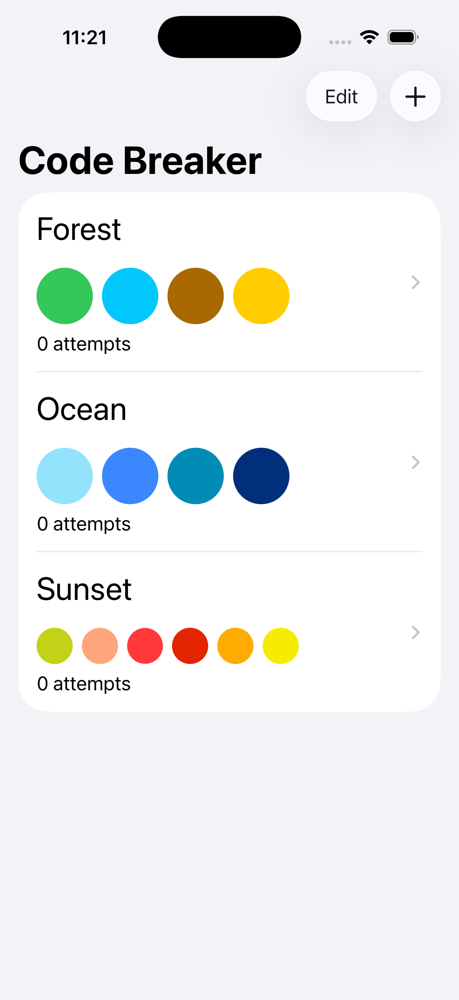
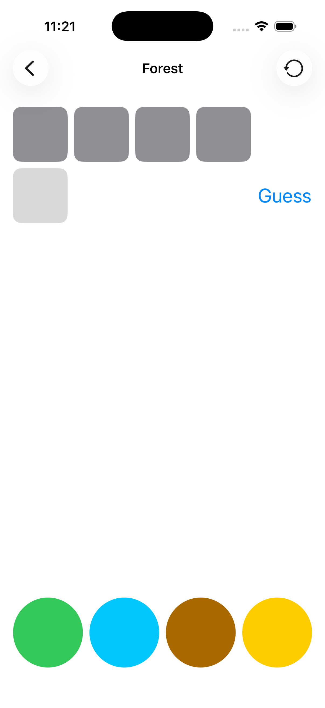
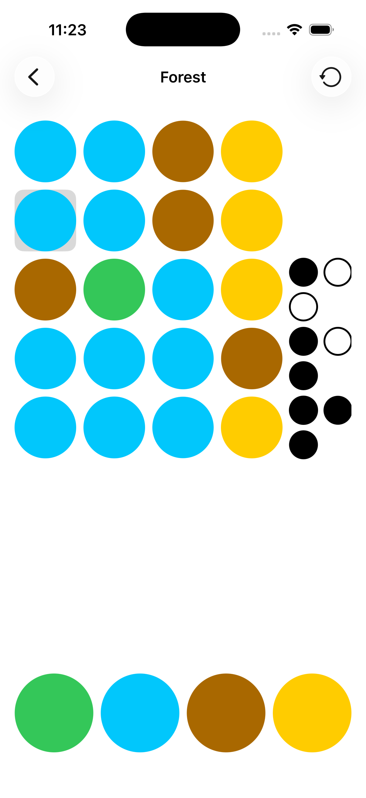

# 简介

这是一个可以在 iPhone/iPad 上运行的 MasterMind 游戏，我在学习 Stanford CS193p 的过程中，与老师一起，经过16节课的时间搭建完成。

项目全面应用了 SwiftUI、SwiftData 的重要机制，其中包含：

- 基础图形绘制与动画处理
- 使用 List、Group、Form 等内置 UI 进行信息展示与界面跳转
- 使用 @State、@Bindable、@Observable 等进行数据传递与状态保持
- 使用 ModelContainer、ModelContext、@Query 进行数据访问与持久化

完成课程学习后，我具有中级 iOS 开发能力，能够熟练阅读 Swift 相关文档，清楚数据传输与界面转换机制，也能够保证数据在本地与外部的持久化。

# App 展示

| Homepage                              | Start                           | End                         |
| ------------------------------------- | ------------------------------- | --------------------------- |
|  |  |  |

# 课程信息

[课程主页](https://cs193p.stanford.edu/)
[讲座视频](https://www.youtube.com/playlist?list=PL2ZNhbGJfUX6iw_HEkg8lpv9-yuWxiXX_)